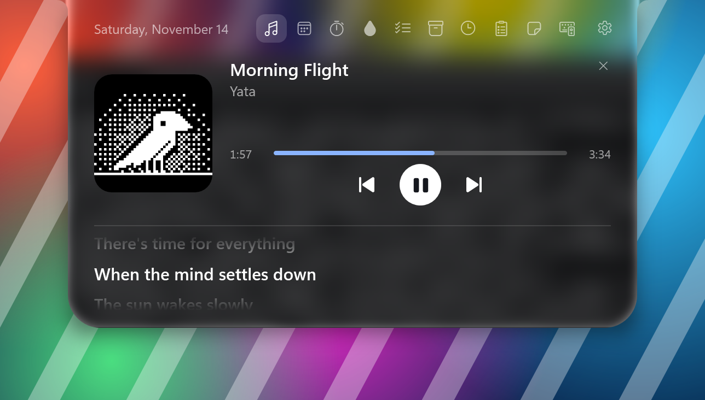

**Yata, Shamil's edition** — the first release of this fork, on top of Yata 0.7.1.

### What's new

- **Themes.** Ten ready-made themes, Liquid Glass among them, or your own five colors; eight clock fonts in three sizes.
- **Clock companions.** Yata or a pixel character beside the clock (cat, ghost, robot, alien, frog, bat, masked hero), or one you draw; they move, react to a click, sleep at night and dance while music plays.
- **Daily tools.** New pages for timers and alarms, the clipboard, notes, and devices and calls.
- **The closed notch.** Badges for network, date, next alarm and task, notifications, the muted microphone, headphone battery and downloads; shortcuts you choose; Ctrl+Alt+H hides the notch completely.
- **Music.** The player's own volume, switching between two players, cleaner browser titles and optional Spotify like, shuffle and repeat.
- **Automatic.** Game summary and game mode, optional prayer times, download progress, optional phone and app notifications, easier file drops.
- **Fixed:** after switching themes while a song played, the lyrics kept the old colors (white on Sakura and Paper).

Screenshots of all of it are in the [README](https://github.com/ShamilJafarov20/yata#readme).

### Install

Download **Yata-Setup-1.0.0.exe** and run it. It installs for your user only, fetches the .NET 10 Desktop Runtime from Microsoft if it's missing, and installs over the original Yata, keeping your data in `%LOCALAPPDATA%\Yata`.

The installer isn't signed, so SmartScreen asks first: **More info** → **Run anyway**. To check the file: `Get-FileHash .\Yata-Setup-1.0.0.exe` in PowerShell must match `SHA256SUMS.txt`.

**Portable:** `Yata-1.0.0-portable.zip` has `Yata.exe` and `yata-cli.exe`; it needs the [.NET 10 Desktop Runtime](https://dotnet.microsoft.com/download/dotnet/10.0) installed.

**Known limitation:** signing in to Google Calendar and Google Tasks doesn't work in this build (it doesn't carry Google OAuth keys); everything else works without them.

Built by GitHub Actions from this tag; `gh attestation verify Yata-Setup-1.0.0.exe --repo ShamilJafarov20/yata` confirms it.
