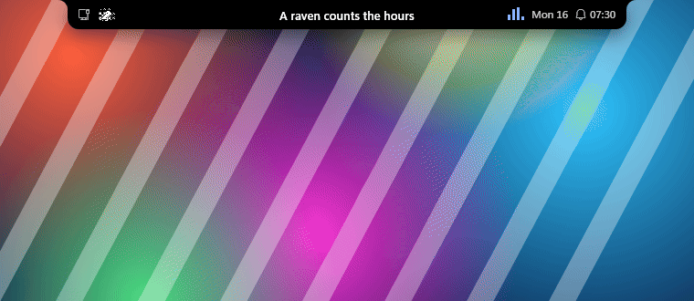
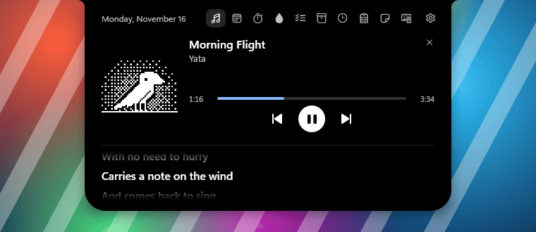
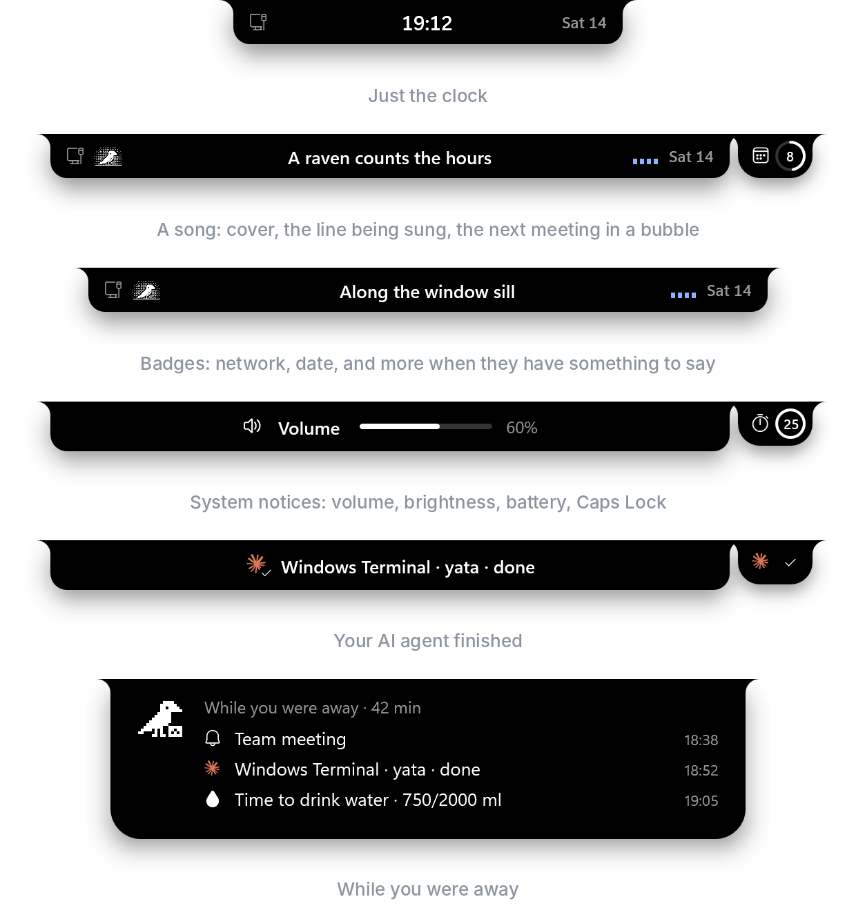
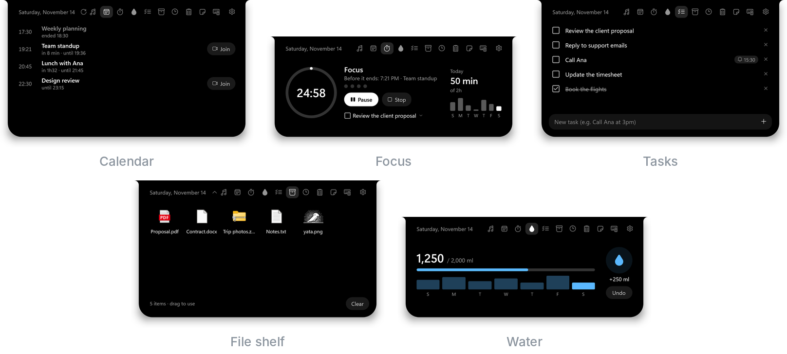

<p align="center">
  <picture>
    <source media="(prefers-color-scheme: dark)" srcset="docs/brand/yata-lockup-white.svg">
    
  </picture>
</p>

<h3 align="center">The live notch Windows never had.</h3>

<p align="center">
  Music with synced lyrics, your next meeting, timers, notes and a pixel raven —<br>
  right under your camera, out of the way until you need it.
</p>

<p align="center">
  <a href="https://github.com/ShamilJafarov20/yata/releases/latest"></a>
</p>

<p align="center">
  <a href="https://github.com/ShamilJafarov20/yata/releases/latest"></a>
  <a href="https://github.com/ShamilJafarov20/yata/releases"></a>
  
  <a href="LICENSE"></a>
</p>

<p align="center"><b>English</b> · <a href="README.ru.md">Русский</a></p>

<p align="center">
  
</p>

<p align="center"><sub>Free and open source · no account · no telemetry · a ~4 MB installer</sub></p>

<table>
  <tr>
    <td width="33%" valign="top">
      <h4>🎵 Music, front and center</h4>
      Any player that uses the Windows media controls — Spotify, YouTube in the browser and the rest — with synced lyrics and a volume bar for just that app.
    </td>
    <td width="33%" valign="top">
      <h4>🎨 Ten themes</h4>
      Liquid Glass that bends whatever is behind it, Neon, Sakura, Paper… or your own five colors. Eight clock fonts.
    </td>
    <td width="33%" valign="top">
      <h4>🐦‍⬛ A companion by the clock</h4>
      Yata the raven, a cat, a robot, a ghost — or one you draw yourself, pixel by pixel.
    </td>
  </tr>
  <tr>
    <td width="33%" valign="top">
      <h4>⏱️ Daily tools</h4>
      Type “pizza 12m” for a timer or “7:30 daily” for an alarm. Clipboard history, notes, Bluetooth batteries, microphone mute.
    </td>
    <td width="33%" valign="top">
      <h4>📅 Your day</h4>
      Google Calendar with a <b>Join</b> button, Pomodoro focus, tasks that become reminders, a water goal and a file shelf.
    </td>
    <td width="33%" valign="top">
      <h4>🤖 Your AI agents</h4>
      Claude Code, Cursor and Codex show when they’re working, waiting for you or done — one click takes you to their terminal.
    </td>
  </tr>
</table>

## 🎨 Make it yours

<p align="center">
  
</p>

Ten ready-made themes — Midnight, **Liquid Glass**, Graphite, Neon, Ocean, Forest, Sunset, Violet, Sakura and Paper — or your own five colors. The clock comes in eight fonts (Thin, Bold, Condensed, Digital, Serif, Handwritten…) and three sizes.

<p align="center">
  
</p>

**Liquid Glass** blurs and bends whatever is behind the notch, adapts its tint so the text stays readable on bright backgrounds, and follows the motion behind it at up to ~120 frames a second (adjustable, to save power).

## 🐦‍⬛ Clock companions

<p align="center"></p>

Yata the raven or a pixel friend sits by the clock: cat, ghost, robot, alien, frog, bat, masked hero — or **one you draw** in a 16×14 editor (with an eyes tool, mirroring and picture import). Each has its own moves: the cat flicks its tail, the robot scans, the bat flaps. They answer when clicked, say hello once a day, sleep at night and dance in the closed notch while music plays.

<p align="center"></p>

<p align="center"><sub>Yata is named after <b>Yatagarasu</b> (八咫烏), the messenger crow of Japanese mythology. It naps when you’re away, caws when it brings a reminder, and flies in with a letter of what you missed when you come back.</sub></p>

## 🔔 The closed notch

<p align="center">
  
</p>

Closed, Yata is a slim bar that speaks only when it has something to say:

- **Badges** for network, date, next alarm and task, unread notifications, a muted microphone, headphone battery and downloads.
- **System notices** for volume, brightness, charger and battery, audio output, Caps Lock and keyboard language — read with no keyboard hook.
- **A bubble beside the notch**, like the iPhone’s island splitting in two, for the next meeting, the focus countdown and other programs’ activities.
- **Your shortcuts**: open and close, hide the notch completely (Ctrl+Alt+H), play/pause, next, previous, player volume, a Spotify like, microphone mute.

<p align="center"></p>

## 🧰 Daily tools

<p align="center"></p>

- **Timers and alarms** — type “10m”, “pizza 12m” or “7:30 daily”; a stopwatch with laps. Alarms ring during games too, without popping over them.
- **Clipboard** — the last 12 copies, in memory only (password managers are skipped). After Win+Shift+S the notch offers Copy / Save / Open.
- **Notes** — a scratchpad saved as you type.
- **Devices and calls** — Bluetooth headphone and mouse batteries, microphone mute and “silence call apps” for Discord, Teams or games, Wi-Fi status and a speed test.

## 📅 Your day

<p align="center"></p>

- **Calendar** — today and tomorrow from Google Calendar, a **Join** button for Meet, Zoom and Teams, and “Standup in 8 min” in the closed notch.
- **Focus** — Pomodoro with a countdown in the notch, tied to a task, against a daily goal.
- **Tasks** — a time in the text (“Call Ana at 3pm”) becomes a reminder; optional two-way sync with Google Tasks.
- **Water** — a daily goal and gentle hourly reminders, if you want them.
- **File shelf** — drop files on the notch, drag them out into any app later.

## 🤖 Made for AI agents and scripts

Claude Code, Cursor and Codex show up beside the notch with their own logo — **working**, **waiting for you** or **done** — one bubble per session. Click it and you’re in the terminal that needs you. Turn the hooks on in **Settings → AI agents**; only the state reaches the notch, never prompts, commands or answers.

Your own scripts and builds can do the same with `yata-cli`:

```powershell
yata-cli activity set build --title "Build" --text "compiling" --progress 40% --icon code
yata-cli activity done build --title "Build" --text "ok"
```

More in [docs/DEVELOPMENT.md](docs/DEVELOPMENT.md#activities).

## 🤫 Knows when to be quiet

- **Hides in full screen** — videos, games and presentations. Reminders that come meanwhile wait and show up afterwards, chime included.
- **Stays out of screen sharing** — Teams, Meet, Zoom, OBS and screenshots don’t capture the notch, so your meetings and tasks aren’t shown to others. You still see it.
- **No chime during calls** or when Windows says not to disturb; a reminder that’s no longer true (“Standup in 5 min” after it started) is dropped.

## ⬇️ Install

1. Download **`Yata-Setup-x.y.z.exe`** from [Releases](https://github.com/ShamilJafarov20/yata/releases/latest) (~4 MB) and run it.
2. Windows SmartScreen will warn because the installer isn’t signed yet: click **More info**, then **Run anyway**.
3. That’s it. Yata installs for your user only, without administrator rights, and appears at the top of the screen.

<details>
<summary><b>Requirements, portable version and checking the download</b></summary>

- **Requirements:** Windows 10 (2004 or newer) or Windows 11, 64-bit.
- If the **.NET 10 Desktop Runtime** is missing, the installer downloads it from Microsoft, checks Microsoft’s signature and installs it (that one step asks for administrator rights).
- It installs over the original Yata, and uninstalling keeps your data in `%LOCALAPPDATA%\Yata`.
- A **portable** zip is on every release too; it needs the .NET 10 Desktop Runtime installed.
- **Check the download:** `Get-FileHash .\Yata-Setup-x.y.z.exe` in PowerShell must match the release’s `SHA256SUMS.txt`, and `gh attestation verify Yata-Setup-x.y.z.exe --repo ShamilJafarov20/yata` confirms it was built by GitHub Actions from this repository.
- Signing in to Google Calendar and Google Tasks needs Google OAuth keys, which this repository’s builds don’t carry yet; everything else works without them.

</details>

## 🔒 Privacy

Everything stays on your PC: tasks, water, focus time and shelf paths live in `%LOCALAPPDATA%\Yata\data.json`, next to a 7-day diagnostic log with no songs, tasks, events, paths or accounts. Yata goes online only for what you turn on:

| What | Where it goes | What it sends |
| --- | --- | --- |
| Lyrics | [LRCLIB](https://lrclib.net) | the song’s artist, title and length |
| Weather *(off by default)* | [Open-Meteo](https://open-meteo.com) | the city’s coordinates, rounded to ~1 km |
| Calendar and tasks | Google, directly | reads your calendars; syncs one Google Tasks list if you choose. The sign-in is kept encrypted (DPAPI) |
| New version notice *(off by default)* | this repository’s releases | nothing but the request, once a day |
| Spotify controls, speed test | Spotify Web API (your own Client ID), Cloudflare | only when you use them |

The clipboard history (in memory) and Windows’ notification list (read-only) are read only if you turn them on. Yata uses no AI model or service. Details in [PRIVACY.md](PRIVACY.md).

## ❓ FAQ

<details>
<summary><b>Will it get in the way of games?</b></summary>

No. Yata hides in full screen, holds its reminders until you’re done, and its alarms ring without popping over the game. A game mode keeps every notice but alarms away.
</details>

<details>
<summary><b>Why does Windows warn me when I install it?</b></summary>

The installer isn’t code-signed yet, so SmartScreen doesn’t know it. You can check that the file is the one GitHub Actions built from this code — see <i>Checking the download</i> under Install.
</details>

<details>
<summary><b>How do I hide it for a moment?</b></summary>

Ctrl+Alt+H hides the notch completely and brings it back. Ctrl+Alt+Y opens and closes it from anywhere. To quit, use the tray icon.
</details>

<details>
<summary><b>Which languages does it speak?</b></summary>

The app is in English and Portuguese, following the Windows language, or pick one in Settings → Language.
</details>

<details>
<summary><b>How is this different from the original Yata?</b></summary>

This is a fork of <a href="https://github.com/akaneni/yata">Yata by akaneni</a>, who made the notch and the raven. This version adds the themes and Liquid Glass, the clock companions, the daily tools, the closed-notch badges, your own shortcuts, per-app volume, player switching and more — see <a href="CHANGELOG.md">the changelog</a>.
</details>

<details>
<summary><b>Everything Yata does</b></summary>

- **Welcome**: the first time, Settings open with what the notch can do and the choices that are yours (water reminders, new version notice). The tray menu has **Open Yata**.
- **Compact notch**: a clock when nothing is playing; album art, title and an animated equalizer when media is.
- **Expands on hover** with a spring animation; collapses when the mouse leaves.
- **Media player** for any app that uses the Windows media controls (Spotify, YouTube in the browser, etc.): album art, title, artist, a seekable progress bar, previous/play/next. With several players open, it follows the one that is **actually playing**.
- **Synced lyrics**: under the player in the open notch, three lines with the current one highlighted; clicking a line jumps to it. The compact notch shows the line being sung.
- **System notices** in the compact notch: volume/mute, brightness, charger plugged/unplugged, low battery (20% and 10%), audio output change (headphones/speakers), Caps Lock, keyboard language change and network connection. The keyboard is read by polling its state, **with no hook** — the app never sees what you type.
- **Camera and microphone in use**: an orange (microphone) or green (camera) dot in the closed notch and the apps' names in the open notch. The microphone comes from Windows audio sessions (Core Audio). The camera relies on the registry Windows kept up to version 25H2; on Windows 11 26H2 that data requires administrator rights, so there only the microphone is detected.
- **Ctrl+Alt+Y shortcut** opens and closes the notch from anywhere. **Ctrl+Alt+J** (off by default) goes to the window of the activity that needs you, and pressed again, to the next one. Both use `RegisterHotKey`: Windows reports only those combinations.
- **Multiple displays**: choose in Settings which display the notch sits on; it respects each display's scaling.
- **Calendar (Google)**: connect your Google account (OAuth, read-only) and choose which calendars appear. The tab shows today and tomorrow, highlights the ongoing event and has a **Join** button for Meet, Zoom and Teams calls. The closed notch shows "Standup in 8 min" in the 15 minutes before, and a notice (with sound) arrives a configurable few minutes before, plus another when the event starts. Declined invitations don't appear. To register the app with Google, see [docs/google-calendar.md](docs/google-calendar.md).
- **Weather** (off by default): pick the city by name or, if you prefer, with a single reading of the Windows location (rounded to ~1 km right away, never stored precisely). No IP geolocation. 1-bit pixel-art icons in Yata's style. The closed notch shows the icon and temperature next to the clock; open with no music, it shows the condition, high/low and expected rain. A notice arrives when the chance of rain goes over 60% in the next 2 hours. Weather data: [Open-Meteo.com](https://open-meteo.com) (CC BY 4.0).
- **Focus (Pomodoro)**: 25 min of focus / 5 min break, a 15 min long break every 4 sessions, a sound at the end of each phase and a countdown in the compact notch. Explicit controls for each state: **Start**, **Pause**, **Resume**, **Stop** and **Skip break**. Pick the task the session is for from the Tasks tab and tick it off right there; beside it, today's focus against a daily goal (2 h by default) and the last 7 days.
- **Water**: a daily goal, a +250 ml button, a chart of the last 7 days and an optional hourly reminder (8:00–22:00) until the goal is reached (off until you turn it on).
- **Tasks**: a list with check/remove (a removal can be undone for a few seconds); a time at the end of the text ("Call Ana at 3pm", "Meeting 15:30") becomes a reminder. Optionally syncs both ways with a **Google Tasks** list (Google keeps only the day; the reminder time stays in Yata). The notch takes keyboard focus only while you type and gives it back to the previous window when you're done.
- **File shelf**: drag files or folders onto the notch to keep them and drag them back out into any app; double-click opens. Only the path is kept (nothing is copied), and deleted or moved items disappear on their own. Images get a thumbnail. "Clear" can also be undone for a few seconds.
- **Yata (the companion)**, based on the time since the last mouse/keyboard input (`GetLastInputInfo` — only the time, never the content):
  - **Ambient mode** (2 min idle, nothing playing): the clock gives way to Yata perched, blinking, looking around and settling; at 10 min it naps.
  - **With music playing** while you're away: it takes the equalizer's place and bobs its head.
  - **"While you were away"**: when you come back, Yata flies in with a letter and the notices you missed (reminders, water, battery, paused focus).
  - **Messenger**: reminders (tasks, water, focus, new version) arrive with Yata cawing in place of the icon; small wins get a celebration.
  - **Automatic focus pause** after 5 min away (giving back the unattended time), unless media is playing.
  - **Demo** from the tray menu (or `Yata.exe --demo`) to see every state in ~30 s.
- **Settings** (the gear in the notch, the tray menu or a double-click on the tray icon): language, start with Windows, hide in full screen, hover delay, album art color or black and white, lyrics, each kind of notice, Pomodoro times, water goal and reminders, and Yata's behavior. Everything applies immediately.
- **Now, not at the next round**: **Check now** for a new version, **↻** on the Agenda and Tasks tabs and **Sync now** read Google at once, **Refresh now** fetches the forecast.
- **Bubble beside the notch**: a second small notch, a pill with what it is on one end (the program's icon, the agent's logo) and how it's going on the other. One at a time, by priority (what needs you, the meeting, focus, activities); hover it to see what it is and how many others are waiting. While the notch is open, the bubble grows into a second notch that lists every activity, each with a way to its window and a way to dismiss it.
- Doesn't steal focus and doesn't show in Alt+Tab or the taskbar. Quit from the tray icon.

**Also:** the player's own volume (turns down only the app playing, not the game or the call); switching between two players with ⇄; cleaner browser titles ("Song / Artist · Opera"); optional Spotify like, shuffle and repeat with your own Client ID; a game summary and a game mode with no notices except alarms; optional prayer times; download progress beside the notch; optional phone and app notifications from Phone Link, Telegram, WhatsApp and Discord.

</details>

## 🛠️ Build from source

```powershell
dotnet run --project src/Yata
dotnet test
```

The activities API, the AI agent hooks, translations, the code's structure and how releases are made are in [docs/DEVELOPMENT.md](docs/DEVELOPMENT.md). Every image on this page is drawn by Yata itself with made-up content: the screenshots by `tools/make-shots.ps1`, the animations by `tools/make-reel.ps1`.

## 💜 Credits

Made by [ShamilJafarov20](https://github.com/ShamilJafarov20), on top of [Yata by akaneni](https://github.com/akaneni/yata), who created the notch, the raven and its art. Third-party notices are in [THIRD-PARTY-NOTICES.md](THIRD-PARTY-NOTICES.md).

If Yata made your Windows a bit nicer, a ⭐ helps others find it.

[MIT license](LICENSE).
