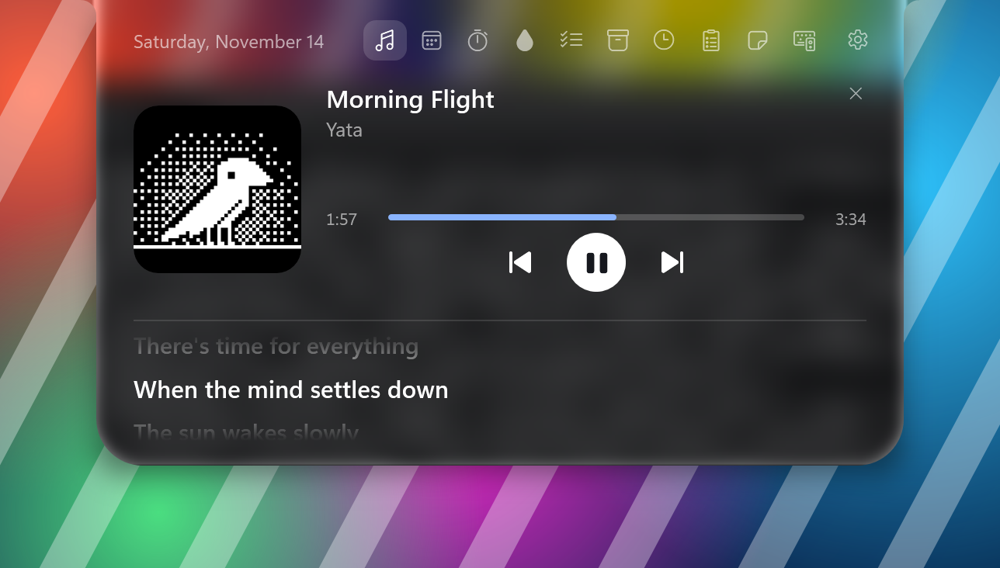
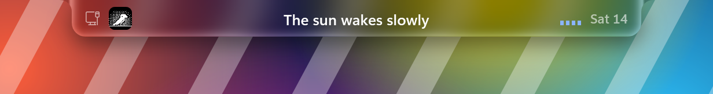
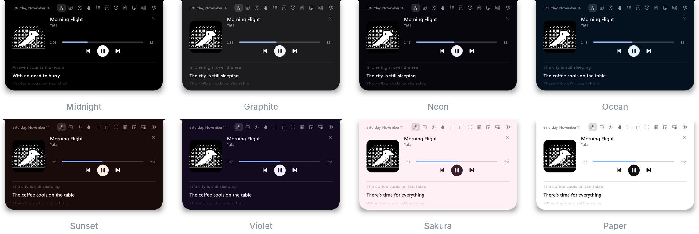
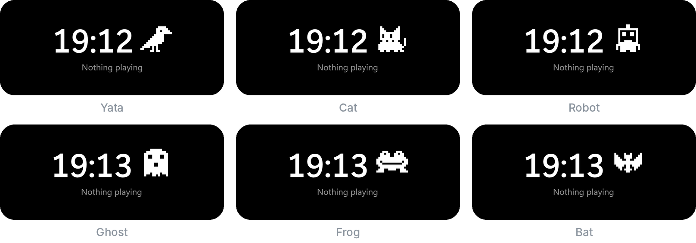
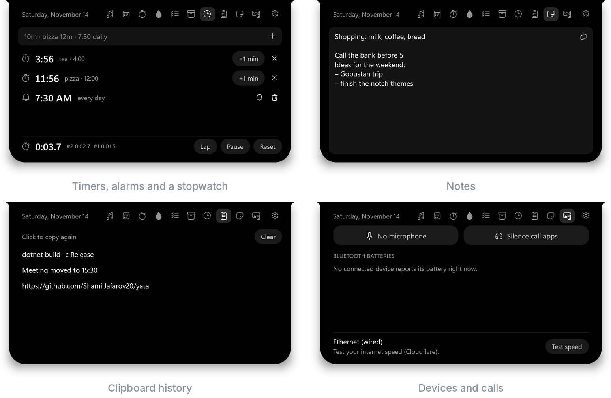

<p align="center"></p>

<p align="center"><b>A live notch for Windows.</b><br>
What's playing with synced lyrics, your next meeting, timers, notes and a pixel raven by the clock — at the top of the screen, right below the camera, out of the way until you need it.</p>

<p align="center">
  <a href="https://github.com/ShamilJafarov20/yata/releases/latest"></a>
  <a href="https://github.com/ShamilJafarov20/yata/releases"></a>
  
  <a href="LICENSE"></a>
</p>

<p align="center"><a href="https://github.com/ShamilJafarov20/yata/releases/latest"><b>⬇ Download for Windows</b></a> · <a href="#install">How to install</a> · <a href="CHANGELOG.md">What's new</a></p>

<p align="center"></p>

Open source, no account, no telemetry. Free.

## Highlights

- **Music, front and center** — any player that uses the Windows media controls (Spotify, YouTube in the browser…), with synced lyrics and a volume bar for just that app.
- **Ten themes**, Liquid Glass among them, or your own colors.
- **A companion by the clock** — Yata the raven, a cat, a robot, a ghost… or one you draw.
- **Daily tools** — timers and alarms, clipboard history, notes, devices and calls.
- **Your day** — Google Calendar with a Join button, Pomodoro focus, water, tasks with reminders, a file shelf.
- **Knows when to be quiet** — hides in games and full screen, stays out of screen sharing, keeps reminders for later.
- **Talks to your tools** — scripts and AI agents (Claude Code, Cursor, Codex) show their progress beside the notch.

## Themes

<p align="center"></p>

<p align="center"></p>

Ten ready-made themes — Midnight, **Liquid Glass**, Graphite, Neon, Ocean, Forest, Sunset, Violet, Sakura, Paper — or your own five colors. Liquid Glass blurs and bends whatever is behind the notch, with a tint that adapts to bright backgrounds so the text stays readable, and follows motion behind it at up to ~120 frames a second (adjustable, to save power). The clock comes in eight fonts (Thin, Bold, Condensed, Digital, Serif, Handwritten…) and three sizes.

## Clock companions

<p align="center"></p>

Yata the raven or an original pixel character sits by the clock: cat, ghost, robot, alien, frog, bat, masked hero — or **one you draw yourself** in a 16×14 editor (with an eyes tool, mirror and picture import). Each one has its own moves (the cat flicks its tail, the robot scans, the bat flaps…), answers when you click it, says hello once a day, sleeps at night and dances in the closed notch while music plays.

## Daily tools

<p align="center"></p>

- **Timers and alarms** — type "10m", "pizza 12m" or "7:30 daily"; a stopwatch with laps. Alarms ring during games too, without popping over them.
- **Clipboard** — the last 12 copies, in memory only (password managers are skipped). After Win+Shift+S the notch offers Copy / Save / Open.
- **Notes** — a scratchpad saved as you type.
- **Devices and calls** — Bluetooth headphone and mouse batteries, microphone mute and "silence call apps" for any app (Discord, Teams, games), Wi-Fi status and a speed test.

## Your day

<p align="center"></p>

- **Calendar** — today and tomorrow from Google Calendar, a **Join** button for Meet, Zoom and Teams, and "Standup in 8 min" in the closed notch.
- **Focus** — Pomodoro with a countdown in the notch, tied to a task, against a daily goal.
- **Tasks** — a time in the text ("Call Ana at 3pm") becomes a reminder; optional sync with Google Tasks.
- **Water** — a daily goal and gentle hourly reminders, if you want them.
- **File shelf** — drop files on the notch, drag them out into any app later.

## The closed notch

<p align="center"></p>

- **Badges** for network, date, next alarm and task, unread notifications, a muted microphone, headphone battery and downloads — each only when it has something to say. An optional ticker alternates the clock with them.
- **System notices** for volume, brightness, charger and battery, audio output, Caps Lock and keyboard language — with no keyboard hook.
- **A bubble beside the notch**, like the iPhone's island splitting in two, for the next meeting, the focus countdown and other programs' activities.
- **Your shortcuts** for open/close, hide the notch completely (Ctrl+Alt+H), play/pause, next, previous, player volume, like on Spotify, microphone mute and silencing call apps.

## Meet Yata

<p align="center"></p>

Yata is a 1-bit pixel-art raven, named after **Yatagarasu** (八咫烏), the messenger crow of Japanese mythology. It blinks, looks around and naps when you're away, caws when it brings a reminder, and flies in with a letter of what you missed when you come back.

<details>
<summary><b>Everything Yata does</b></summary>

- **Welcome**: the first time, Settings open with what the notch can do and the choices that are yours (water reminders, new version notice). The tray menu has **Open Yata**.
- **English and Portuguese**: follows the Windows language (Portuguese on any Portuguese Windows, English everywhere else), or pick one in Settings → Language.
- **Compact notch**: a clock when nothing is playing; album art, title and an animated equalizer when media is.
- **Expands on hover** with a spring animation; collapses when the mouse leaves.
- **Media player** for any app that uses the Windows media controls (Spotify, YouTube in the browser, etc.): album art, title, artist, a seekable progress bar, previous/play/next. With several players open, it follows the one that is **actually playing**.
- **Synced lyrics**: under the player in the open notch, three lines with the current one highlighted; clicking a line jumps to it. The compact notch shows the line being sung.
- **System notices** in the compact notch: volume/mute, brightness, charger plugged/unplugged, low battery (20% and 10%), audio output change (headphones/speakers), Caps Lock, keyboard language change and network connection. The keyboard is read by polling its state, **with no hook** — the app never sees what you type.
- **Camera and microphone in use**: an orange (microphone) or green (camera) dot in the closed notch and the apps' names in the open notch. The microphone comes from Windows audio sessions (Core Audio). The camera relies on the registry Windows kept up to version 25H2; on Windows 11 26H2 that data requires administrator rights, so there only the microphone is detected.
- **Ctrl+Alt+Y shortcut** opens and closes the notch from anywhere. **Ctrl+Alt+J** (off by default) goes to the window of the activity that needs you, and pressed again, to the next one. Both use `RegisterHotKey`: Windows reports only those combinations.
- **Multiple displays**: choose in Settings which display the notch sits on; it respects each display's scaling.
- **Tabs in the open notch**: Media, Calendar, Focus, Water, Tasks and Shelf.
- **Calendar (Google)**: connect your Google account (OAuth, read-only) and choose which calendars appear. The tab shows today and tomorrow, highlights the ongoing event and has a **Join** button for Meet, Zoom and Teams calls. The closed notch shows "Standup in 8 min" in the 15 minutes before, and a notice (with sound) arrives a configurable few minutes before, plus another when the event starts. Declined invitations don't appear. To register the app with Google, see [docs/google-calendar.md](docs/google-calendar.md).
- **Weather** (off by default): pick the city by name or, if you prefer, with a single reading of the Windows location (rounded to ~1 km right away, never stored precisely). No IP geolocation. 1-bit pixel-art icons in Yata's style. The closed notch shows the icon and temperature next to the clock; open with no music, it shows the condition, high/low and expected rain. A notice arrives when the chance of rain goes over 60% in the next 2 hours. Weather data: [Open-Meteo.com](https://open-meteo.com) (CC BY 4.0).
- **Focus (Pomodoro)**: 25 min of focus / 5 min break, a 15 min long break every 4 sessions, a sound at the end of each phase and a countdown in the compact notch. Explicit controls for each state: **Start**, **Pause**, **Resume**, **Stop** and **Skip break**; when paused, the ring dims and the time pulses gently (and the compact notch shows ⏸). Pick the task the session is for from the Tasks tab and tick it off right there; beside it, today's focus against a daily goal (2 h by default, in Settings) and the last 7 days.
- **Water**: a daily goal, a +250 ml button, a chart of the last 7 days and an optional hourly reminder (8:00–22:00) until the goal is reached (off until you turn it on, on the welcome card or in Settings).
- **Tasks**: a list with check/remove (a removal can be undone for a few seconds); a time at the end of the text ("Call Ana at 3pm", "Meeting 15:30", "ligar às 9h") becomes a reminder. Optionally syncs both ways with a **Google Tasks** list (Google keeps only the day; the reminder time stays in Yata). The notch takes keyboard focus only while you type and gives focus back to the previous window when you're done.
- **File shelf**: drag files or folders onto the notch to keep them and drag them back out into any app; double-click opens. Only the path is kept (nothing is copied), and deleted/moved items disappear on their own. Images get a thumbnail. "Clear" can also be undone for a few seconds.
- **Yata (the companion)**, based on the time since the last mouse/keyboard input (`GetLastInputInfo` — only the time, never the content):
  - **Ambient mode** (2 min idle, nothing playing): the clock gives way to Yata perched, blinking, looking around and settling; at 10 min it naps.
  - **With music playing** while you're away: it takes the equalizer's place and bobs its head.
  - **"While you were away"**: when you come back, Yata flies in with a letter and the notices you missed (reminders, water, battery, paused focus).
  - **Messenger**: reminders (tasks, water, focus, new version) arrive with Yata cawing in place of the icon; small wins get a celebration (a flight at the end of focus, a shake at the water goal).
  - **Automatic focus pause** after 5 min away (giving back the unattended time), unless media is playing.
  - **Demo** from the tray menu (or `Yata.exe --demo`) to see every state in ~30 s.
- **Settings** (the gear in the notch, the menu or a double-click on the tray icon): language, start with Windows, hide in full screen, hover delay, album art color or black and white, lyrics on/off, each kind of notice, Pomodoro times, water goal and reminders, and Yata's behavior. Everything applies immediately.
- **Now, not at the next round**: **Check now** for a new version (Settings → Updates, or the tray menu, even with the daily check off); **↻** on the Agenda and Tasks tabs and **Sync now** in Settings read Google at once; **Refresh now** fetches the forecast. Each shows when it last ran, and a second click within 15 seconds doesn't go online again.
- Reminders that arrive while the notch is open or in full screen wait and show up afterwards, one at a time, instead of being lost. A status blip (volume, Caps Lock) shows at once and the reminder it interrupted comes back right after.
- **Bubble beside the notch**: like the iPhone's island splitting in two, a second small notch, a pill with what it is on one end (the program's icon, the agent's logo) and how it's going on the other, carries what doesn't fit in the first: while music has the notch, the focus countdown (a ring emptying around the minutes left) and the next meeting move there, and so do other programs' activities. One at a time, by priority (what needs you, the meeting, focus, activities); hover it to see what it is and how many others are waiting. Clicking an activity takes you to the window it came from (the terminal where the agent asks for a permission, say), and you answer there. While the notch is open, the bubble grows into a second notch beside it that lists every activity, each with a way to its window and a way to dismiss it.
- **Activities from other programs** (scripts, builds, AI agents): they can show their progress in the bubble with `yata-cli`. See [Activities](docs/DEVELOPMENT.md#activities) below. Can be turned off in Settings.
- **Hides in full screen** (videos, games, presentations).
- **Out of screen sharing and recordings**: in a Teams/Meet/Zoom call, an OBS stream or a screenshot, the notch isn't captured, so the next meeting, your tasks and your agent's project don't show up for others (you still see it). On by default; `--show` keeps the notch capturable for previews.
- **The chime comes with the reminder**: a reminder held back by a game in full screen chimes when it shows, not in the middle of the match. No chime while the microphone is in use (a call) or Windows says not to disturb, and it can be turned off. A held reminder that's no longer true ("Daily in 5 min" after the meeting started) is dropped instead of shown late.
- Doesn't steal focus and doesn't show in Alt+Tab or the taskbar. Quit from the tray icon.

**Also:** the player's own volume (turns down only the app playing, not the game or the call); switching between two players with ⇄; cleaner browser titles ("Song / Artist · Opera"); optional Spotify like, shuffle and repeat with your own Client ID; a game summary and a game mode with no notices except alarms; optional prayer times; download progress beside the notch; optional phone and app notifications from Phone Link, Telegram, WhatsApp and Discord.

</details>

## Install

1. Download **`Yata-Setup-x.y.z.exe`** from [Releases](https://github.com/ShamilJafarov20/yata/releases/latest) (~4 MB) and run it.
2. Windows SmartScreen will warn because the installer isn't signed yet: click **More info**, then **Run anyway**.
3. That's it. Yata installs for your user only (no administrator rights) and starts at the top of the screen.

If the **.NET 10 Desktop Runtime** is missing, the installer downloads it from Microsoft, checks Microsoft's signature and installs it (that one step asks for administrator rights). It installs over the original Yata, and uninstalling keeps your data in `%LOCALAPPDATA%\Yata`. A **portable** zip is on every release too; it needs the .NET 10 Desktop Runtime installed.

**Check the download:** `Get-FileHash .\Yata-Setup-x.y.z.exe` in PowerShell must match the release's `SHA256SUMS.txt`, and `gh attestation verify Yata-Setup-x.y.z.exe --repo ShamilJafarov20/yata` confirms it was built by GitHub Actions from this repository.

**Requirements:** Windows 10 (2004 or newer) or Windows 11, 64-bit.

> Signing in to Google Calendar and Google Tasks needs Google OAuth keys, which this repository's builds don't carry yet; everything else works without them.

## Privacy

Everything stays on your PC: tasks, water, focus time and shelf paths in `%LOCALAPPDATA%\Yata\data.json`, and a 7-day diagnostic log with no songs, tasks, events, paths or accounts. Yata goes online only for what you turn on:

- **Lyrics** from [LRCLIB](https://lrclib.net) — only the artist, title and length of the song.
- **Weather** from [Open-Meteo](https://open-meteo.com) — the city's coordinates, rounded to ~1 km. Off by default.
- **Google Calendar and Tasks** — directly between the PC and Google, the access encrypted with DPAPI.
- **New version notice** — this repository's public releases page, once a day. Off by default.
- **Spotify Web API** (with your own Client ID) and **Cloudflare's speed test** (only when you press *Test speed*).

The clipboard history (in memory) and Windows' notification list (read-only) are read only if you turn them on. Details in [PRIVACY.md](PRIVACY.md).

## Build from source

```powershell
dotnet run --project src/Yata
dotnet test
```

The activities API, the AI agent hooks, translations, the code's structure and how releases are made are in [docs/DEVELOPMENT.md](docs/DEVELOPMENT.md). The screenshots are drawn by Yata itself with sample content (`tools/make-shots.ps1`).

## Credits

Made by [ShamilJafarov20](https://github.com/ShamilJafarov20). Built on [Yata by akaneni](https://github.com/akaneni/yata), which created the notch, the raven and its art; this version adds the themes, companions, daily tools, badges and more. Third-party notices are in [THIRD-PARTY-NOTICES.md](THIRD-PARTY-NOTICES.md).

[MIT license](LICENSE).
