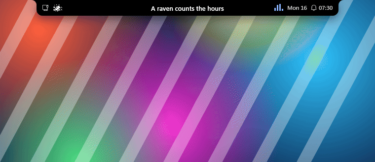
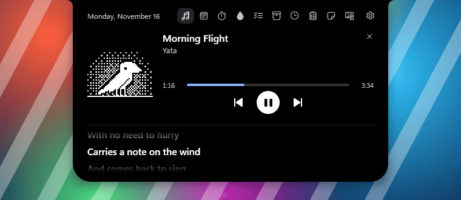
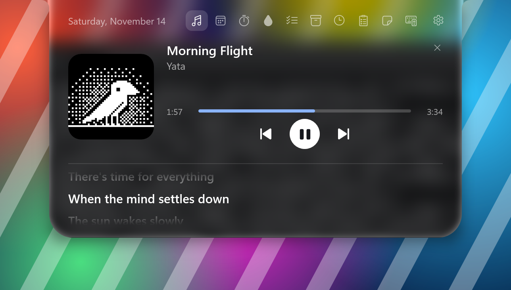
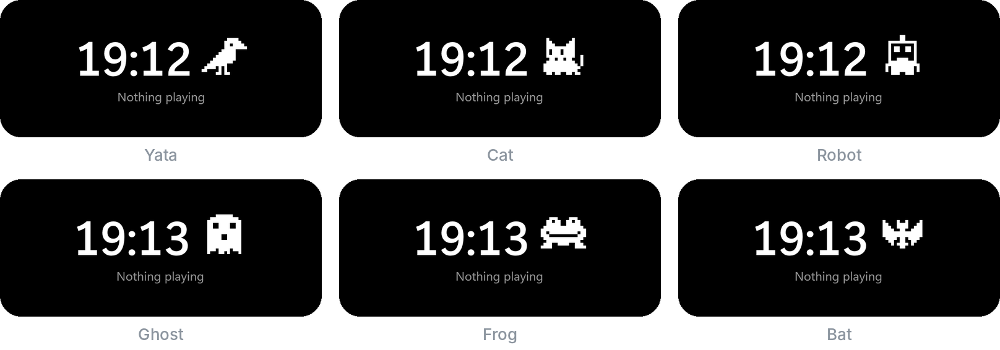
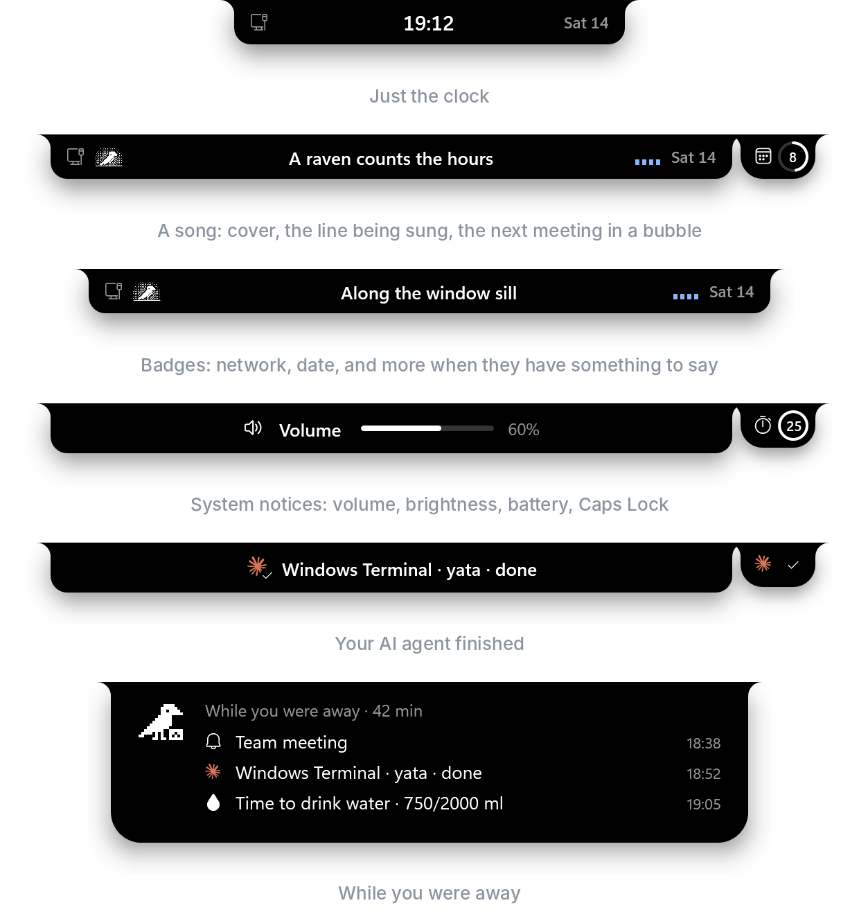
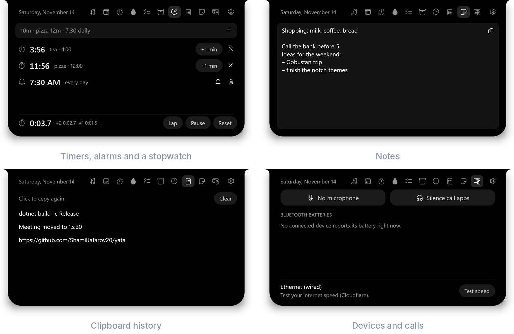
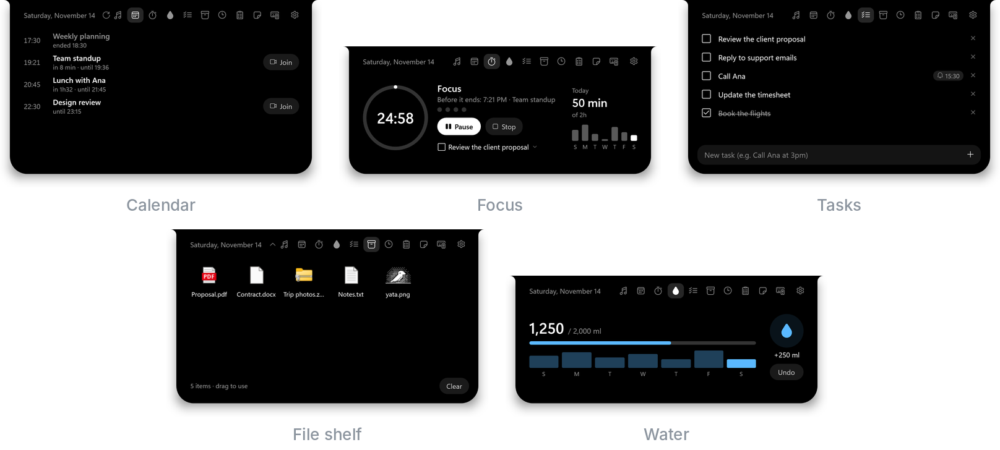

<p align="center">
  <picture>
    <source media="(prefers-color-scheme: dark)" srcset="docs/brand/yata-lockup-white.svg">
    
  </picture>
</p>

<h3 align="center">Живой «вырез» сверху экрана, которого Windows не хватало.</h3>

<p align="center">
  Музыка с синхронным текстом, ближайшая встреча, таймеры, заметки и пиксельный ворон —<br>
  прямо под камерой и не мешают, пока не понадобятся.
</p>

<p align="center">
  <a href="https://github.com/ShamilJafarov20/yata/releases/latest"></a>
</p>

<p align="center">
  <a href="https://github.com/ShamilJafarov20/yata/releases/latest"></a>
  <a href="https://github.com/ShamilJafarov20/yata/releases"></a>
  
  <a href="LICENSE"></a>
</p>

<p align="center"><a href="README.md">English</a> · <b>Русский</b></p>

<p align="center">
  
</p>

<p align="center"><sub>Бесплатно и с открытым кодом · без аккаунта · без телеметрии · установщик ~4 МБ</sub></p>

> Интерфейс самого приложения пока на английском и португальском.

<table>
  <tr>
    <td width="33%" valign="top">
      <h4>🎵 Музыка на виду</h4>
      Любой плеер, который работает с медиаклавишами Windows — Spotify, YouTube в браузере и другие, — с синхронным текстом песни и громкостью только этого приложения.
    </td>
    <td width="33%" valign="top">
      <h4>🎨 Десять тем</h4>
      Liquid Glass, который преломляет всё, что под ним, Neon, Sakura, Paper… или пять своих цветов. Восемь шрифтов часов.
    </td>
    <td width="33%" valign="top">
      <h4>🐦‍⬛ Компаньон у часов</h4>
      Ворон Yata, кот, робот, призрак — или тот, кого вы нарисуете сами, пиксель за пикселем.
    </td>
  </tr>
  <tr>
    <td width="33%" valign="top">
      <h4>⏱️ Инструменты на каждый день</h4>
      Напишите «pizza 12m» — и будет таймер, «7:30 daily» — будильник. История буфера обмена, заметки, заряд Bluetooth-устройств, выключение микрофона.
    </td>
    <td width="33%" valign="top">
      <h4>📅 Ваш день</h4>
      Google Календарь с кнопкой <b>Join</b>, фокус-сессии Pomodoro, задачи, которые сами становятся напоминаниями, норма воды и полка для файлов.
    </td>
    <td width="33%" valign="top">
      <h4>🤖 Ваши AI-агенты</h4>
      Claude Code, Cursor и Codex показывают, что работают, ждут вас или закончили, — клик переносит прямо в их терминал.
    </td>
  </tr>
</table>

## 🎨 Под себя

<p align="center">
  
</p>

Десять готовых тем — Midnight, **Liquid Glass**, Graphite, Neon, Ocean, Forest, Sunset, Violet, Sakura и Paper — или пять своих цветов. У часов восемь шрифтов (Thin, Bold, Condensed, Digital, Serif, Handwritten…) и три размера.

<p align="center">
  
</p>

**Liquid Glass** размывает и изгибает то, что находится под вырезом, подстраивает оттенок, чтобы текст читался даже на светлом фоне, и следит за движением под собой с частотой до ~120 кадров в секунду (настраивается, чтобы беречь батарею).

## 🐦‍⬛ Компаньоны у часов

<p align="center"></p>

Рядом с часами живёт ворон Yata или пиксельный друг: кот, призрак, робот, пришелец, лягушка, летучая мышь, герой в маске — или **ваш собственный**, нарисованный в редакторе 16×14 (с инструментом для глаз, зеркалированием и импортом картинки). У каждого свои движения: кот машет хвостом, робот сканирует, мышь хлопает крыльями. Они отвечают на клик, здороваются раз в день, спят ночью и танцуют в закрытом вырезе, пока играет музыка.

<p align="center"></p>

<p align="center"><sub>Yata назван в честь <b>Ятагарасу</b> (八咫烏), ворона-вестника из японской мифологии. Он дремлет, пока вас нет, каркает, когда приносит напоминание, и прилетает с письмом обо всём пропущенном, когда вы возвращаетесь.</sub></p>

## 🔔 Закрытый вырез

<p align="center">
  
</p>

В закрытом виде Yata — тонкая полоска, которая говорит, только когда есть что сказать:

- **Значки** сети, даты, ближайшего будильника и задачи, непрочитанных уведомлений, выключенного микрофона, заряда наушников и загрузок.
- **Системные уведомления** о громкости, яркости, зарядке и батарее, смене аудиовыхода, Caps Lock и раскладке — без перехвата клавиатуры.
- **Пузырь рядом с вырезом**, как «остров» iPhone, который делится надвое, — для ближайшей встречи, отсчёта фокуса и активностей других программ.
- **Свои горячие клавиши**: открыть и закрыть, полностью спрятать вырез (Ctrl+Alt+H), пауза, следующий и предыдущий трек, громкость плеера, лайк в Spotify, выключение микрофона.

<p align="center"></p>

## 🧰 Инструменты на каждый день

<p align="center"></p>

- **Таймеры и будильники** — напишите «10m», «pizza 12m» или «7:30 daily»; секундомер с кругами. Будильники звонят и во время игр, не выскакивая поверх них.
- **Буфер обмена** — последние 12 копирований, только в памяти (менеджеры паролей пропускаются). После Win+Shift+S вырез предлагает Copy / Save / Open.
- **Заметки** — черновик, который сохраняется на ходу.
- **Устройства и звонки** — заряд Bluetooth-наушников и мыши, выключение микрофона и «заглушить приложения для звонков» для Discord, Teams и игр, состояние Wi-Fi и тест скорости.

## 📅 Ваш день

<p align="center"></p>

- **Календарь** — сегодня и завтра из Google Календаря, кнопка **Join** для Meet, Zoom и Teams и «Standup in 8 min» в закрытом вырезе.
- **Фокус** — Pomodoro с отсчётом в вырезе, привязанный к задаче, с дневной целью.
- **Задачи** — время в тексте («Call Ana at 3pm») превращается в напоминание; по желанию — двусторонняя синхронизация с Google Tasks.
- **Вода** — дневная норма и мягкие напоминания раз в час, если хотите.
- **Полка для файлов** — бросьте файлы на вырез и потом вытащите их в любое приложение.

## 🤖 Для AI-агентов и скриптов

Claude Code, Cursor и Codex появляются рядом с вырезом со своим логотипом — **работает**, **ждёт вас** или **готово**, по пузырю на сессию. Клик — и вы в терминале, который вас ждёт. Включается в **Settings → AI agents**; в вырез попадает только состояние, никогда не промпты, команды или ответы.

Ваши скрипты и сборки могут так же через `yata-cli`:

```powershell
yata-cli activity set build --title "Build" --text "compiling" --progress 40% --icon code
yata-cli activity done build --title "Build" --text "ok"
```

Подробнее — в [docs/DEVELOPMENT.md](docs/DEVELOPMENT.md#activities) (на английском).

## 🤫 Умеет не мешать

- **Прячется в полноэкранном режиме** — видео, игры, презентации. Напоминания, пришедшие в это время, ждут и показываются потом, вместе со звуком.
- **Не попадает в демонстрацию экрана** — Teams, Meet, Zoom, OBS и скриншоты не видят вырез, так что ваши встречи и задачи не увидят другие. Вы сами его видите.
- **Без звука во время звонков** и когда Windows просит не беспокоить; напоминание, которое уже неактуально («Standup in 5 min», когда встреча началась), не показывается.

## ⬇️ Установка

1. Скачайте **`Yata-Setup-x.y.z.exe`** из [Releases](https://github.com/ShamilJafarov20/yata/releases/latest) (~4 МБ) и запустите.
2. Windows SmartScreen предупредит, потому что установщик пока не подписан: нажмите **Подробнее**, затем **Выполнить в любом случае**.
3. Готово. Yata ставится только для вашего пользователя, без прав администратора, и появляется вверху экрана.

<details>
<summary><b>Требования, портативная версия и проверка файла</b></summary>

- **Требования:** Windows 10 (2004 или новее) или Windows 11, 64-бит.
- Если нет **.NET 10 Desktop Runtime**, установщик скачает его с сайта Microsoft, проверит подпись Microsoft и установит (только этот шаг попросит права администратора).
- Ставится поверх оригинального Yata, а при удалении ваши данные остаются в `%LOCALAPPDATA%\Yata`.
- В каждом релизе есть и **портативный** zip; ему нужен установленный .NET 10 Desktop Runtime.
- **Проверка файла:** `Get-FileHash .\Yata-Setup-x.y.z.exe` в PowerShell должен совпасть с `SHA256SUMS.txt` из релиза, а `gh attestation verify Yata-Setup-x.y.z.exe --repo ShamilJafarov20/yata` подтверждает, что файл собран GitHub Actions из этого репозитория.
- Для входа в Google Календарь и Google Tasks нужны ключи Google OAuth, которых в сборках этого репозитория пока нет; всё остальное работает без них.

</details>

## 🔒 Приватность

Всё хранится у вас на ПК: задачи, вода, время фокуса и пути полки — в `%LOCALAPPDATA%\Yata\data.json`, рядом с диагностическим журналом за 7 дней без песен, задач, событий, путей и аккаунтов. В сеть Yata выходит только ради того, что вы сами включили:

| Что | Куда | Что отправляется |
| --- | --- | --- |
| Тексты песен | [LRCLIB](https://lrclib.net) | исполнитель, название и длина песни |
| Погода *(выключена по умолчанию)* | [Open-Meteo](https://open-meteo.com) | координаты города, округлённые до ~1 км |
| Календарь и задачи | напрямую в Google | читает календари; синхронизирует один список Google Tasks, если вы выбрали. Вход хранится зашифрованным (DPAPI) |
| Уведомление о новой версии *(выключено по умолчанию)* | релизы этого репозитория | только сам запрос, раз в день |
| Управление Spotify, тест скорости | Spotify Web API (ваш Client ID), Cloudflare | только когда вы ими пользуетесь |

История буфера обмена (в памяти) и список уведомлений Windows (только чтение) читаются, только если вы их включили. Yata не использует никаких AI-моделей и сервисов. Подробности — в [PRIVACY.md](PRIVACY.md) (на английском).

## ❓ Вопросы

<details>
<summary><b>Не будет мешать в играх?</b></summary>

Нет. Yata прячется в полноэкранном режиме, придерживает напоминания до конца игры, а будильники звонят, не выскакивая поверх неё. Игровой режим убирает все уведомления, кроме будильников.
</details>

<details>
<summary><b>Почему Windows предупреждает при установке?</b></summary>

Установщик пока не подписан сертификатом, поэтому SmartScreen его не знает. Можно убедиться, что файл собран GitHub Actions из этого кода, — см. «Проверка файла» в разделе «Установка».
</details>

<details>
<summary><b>Как ненадолго его спрятать?</b></summary>

Ctrl+Alt+H полностью прячет вырез и возвращает обратно. Ctrl+Alt+Y открывает и закрывает его откуда угодно. Выйти можно через значок в трее.
</details>

<details>
<summary><b>Чем это отличается от оригинального Yata?</b></summary>

Это форк <a href="https://github.com/akaneni/yata">Yata от akaneni</a>, который придумал вырез и ворона. Эта версия добавляет темы и Liquid Glass, компаньонов у часов, инструменты на каждый день, значки в закрытом вырезе, свои горячие клавиши, громкость отдельного приложения, переключение плееров и многое другое — см. <a href="CHANGELOG.md">список изменений</a>.
</details>

## 🛠️ Сборка из исходников

```powershell
dotnet run --project src/Yata
dotnet test
```

API активностей, хуки для AI-агентов, переводы, устройство кода и выпуск релизов описаны в [docs/DEVELOPMENT.md](docs/DEVELOPMENT.md). Все картинки на этой странице Yata рисует сам на выдуманных данных: скриншоты — `tools/make-shots.ps1`, анимации — `tools/make-reel.ps1`.

## 💜 Авторы

Сделал [ShamilJafarov20](https://github.com/ShamilJafarov20) на основе [Yata от akaneni](https://github.com/akaneni/yata), который создал вырез, ворона и его графику. Сторонние лицензии — в [THIRD-PARTY-NOTICES.md](THIRD-PARTY-NOTICES.md).

Если Yata сделал ваш Windows чуточку приятнее, ⭐ поможет другим его найти.

[Лицензия MIT](LICENSE).
